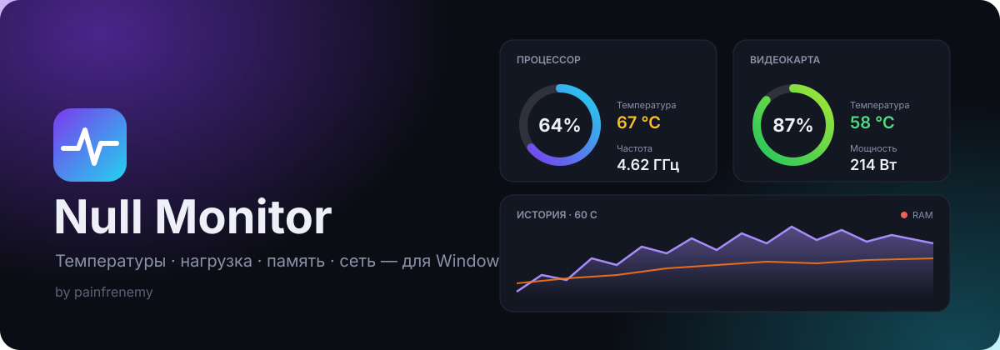
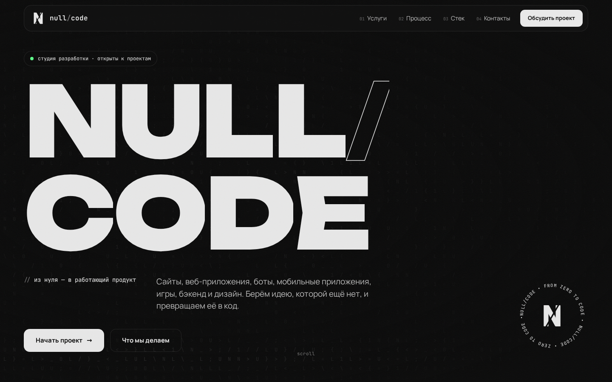
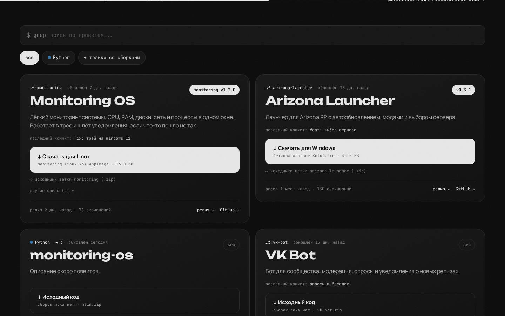
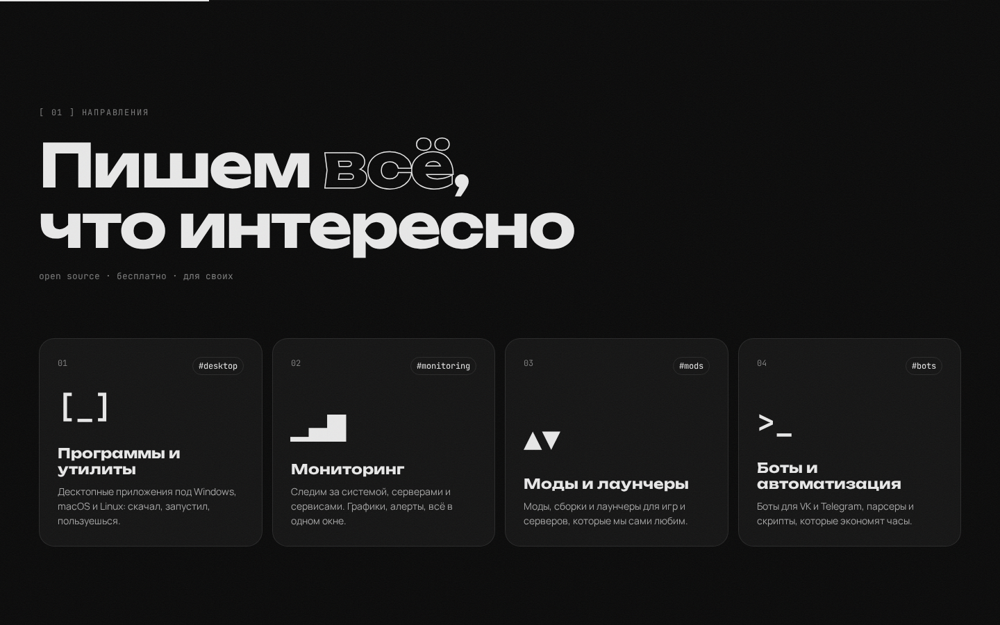
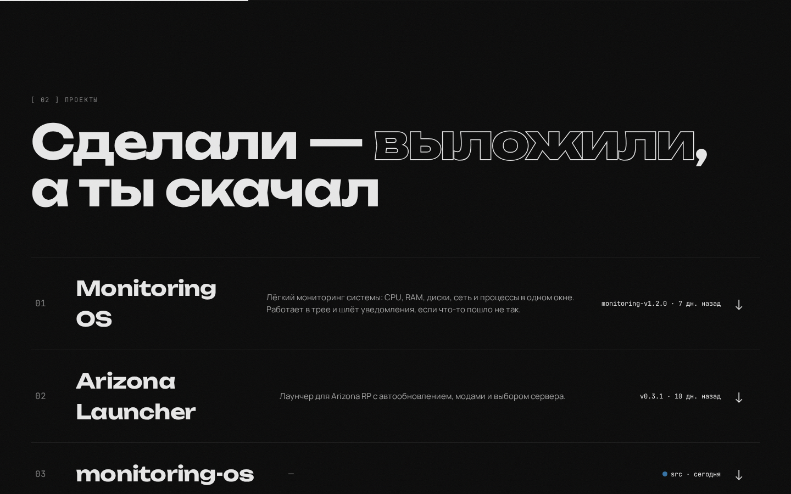
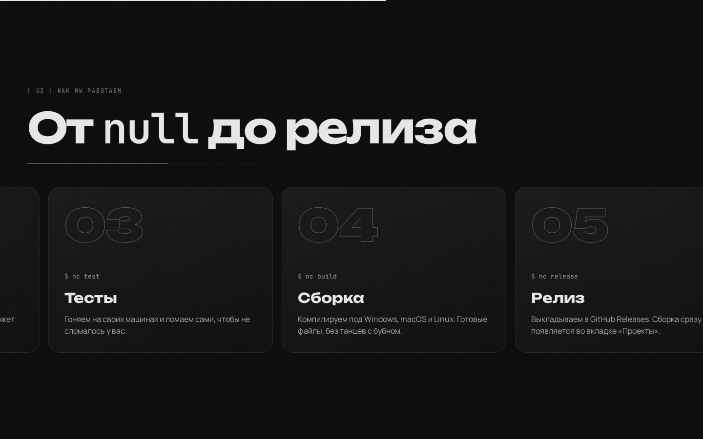
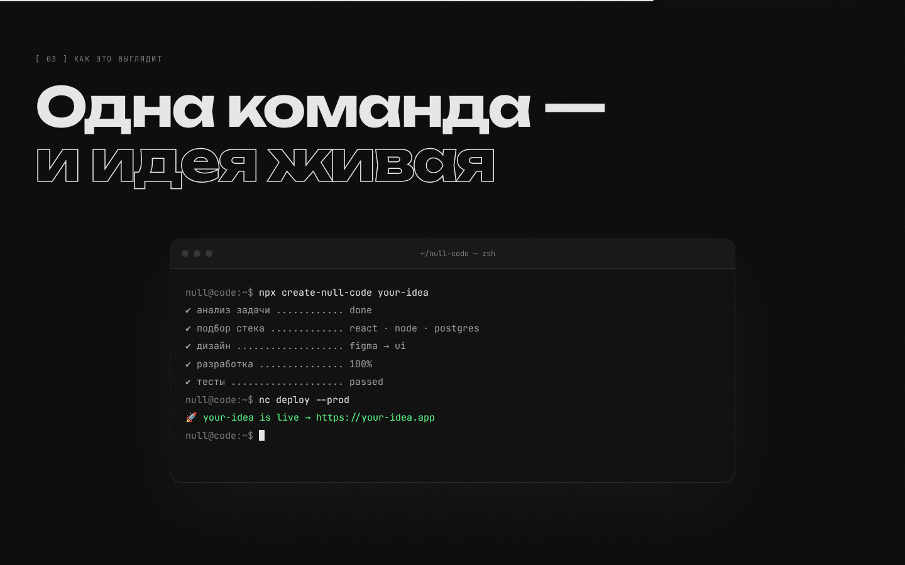
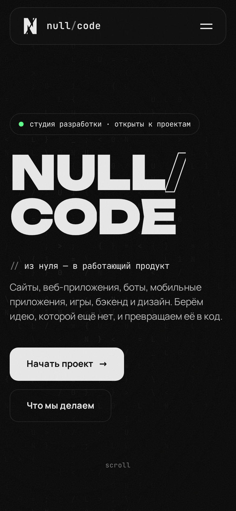

<div align="center">



<br />

**null/code — сообщество, которое делает штуки и выкладывает их в открытый доступ.**

программы · мониторинг · моды · боты · игры · веб

<br />

[](https://react.dev)
[](https://vite.dev)
[](https://motion.dev)
[](https://vk.ru/null.code)

</div>

<br />



## ✦ Вкладка «Проекты»

Сайт сам собирает список проектов с GitHub, базы данных нет. **Каждая ветка этого репозитория — отдельный проект.**



- **Описание** берётся из `README.md` ветки: заголовок `# ...` и первый абзац.
- **Исходники**: кнопка скачивает `.zip` ветки.
- **Сборки** берутся из [GitHub Releases](../../releases). Сайт определяет систему посетителя (Windows / macOS / Linux / Android) и подсвечивает нужный файл. Остальные файлы лежат под «другие файлы».
- **Не показываются** ветки `main` / `master` (сам сайт), `gh-pages` и `claude/*`. Список настраивается в `src/config.js`.
- Отдельные репозитории тоже можно показать: `EXTRA_REPOS` в `src/config.js`.

> ⚠️ **Репозиторий должен быть публичным.** Иначе посетители не увидят ветки и не смогут скачать файлы: GitHub отдаёт приватные данные только авторизованным пользователям.

### Как добавить проект

```bash
# 1. Новая пустая ветка под проект
git checkout --orphan monitoring
git rm -rf .
# ...кладём код проекта и README.md с заголовком и описанием...
git add . && git commit -m "monitoring: init"
git push -u origin monitoring
```

Всё, проект появится на сайте с кнопкой «Исходный код».

### Как выложить готовую сборку

Создайте релиз и прикрепите скомпилированные файлы. Тег начинается с имени ветки:

```bash
gh release create monitoring-v1.0.0 \
  --target monitoring --title "Monitoring 1.0.0" \
  build/monitoring-windows-x64.exe build/monitoring-linux-x64.AppImage build/monitoring-macos.dmg
```

Если сборку делает GitHub Actions прямо из ветки проекта, тег может быть любым (например `v1.0.12`). Сайт свяжет релиз с веткой по коммиту, из которого он собран.

Можно и через сайт GitHub: **Releases → Draft a new release**. В поле *Target* выберите ветку проекта, тег назовите `monitoring-v1.0.0` и перетащите файлы.

Чтобы сайт угадал систему, в имени файла должно быть `windows`/`win`/`.exe`, `mac`/`darwin`/`.dmg`, `linux`/`.AppImage`/`.deb` или `.apk`.

## ✦ Что внутри

| | |
| --- | --- |
| **Прелоадер** | Логотип рисуется линиями, счётчик 000 → 100%, экран уезжает вверх |
| **Hero** | Фон из символов кода на canvas: оживает вокруг курсора, по нему бежит скан-линия. Буквы выезжают по одной, подзаголовок «расшифровывается» |
| **Бегущая строка** | Два ряда направлений навстречу друг другу, наклон зависит от скорости скролла |
| **Манифест** | Слова проявляются по мере прокрутки |
| **Услуги** | Карточки с 3D-наклоном и световым пятном под курсором |
| **Процесс** | Горизонтальная лента этапов внутри вертикального скролла |
| **Терминал** | Сам печатает команды, когда попадает в экран |
| **Проекты** | Превью на главной и отдельная вкладка `#/projects`: поиск, фильтры, загрузки под вашу ОС |
| **Стек и сообщество** | Пружинящие чипы технологий, как помочь проекту, ссылки на VK и GitHub |
| **Мелочи** | Свой курсор, магнитные кнопки, зерно, прогресс-бар, плавный скролл (Lenis), `prefers-reduced-motion`, адаптив |

## ✦ Скриншоты

<table>
  <tr>
    <td width="50%"></td>
    <td width="50%"></td>
  </tr>
  <tr>
    <td width="50%"></td>
    <td width="50%"></td>
  </tr>
</table>

<p align="center">
  
</p>

## ✦ Запуск

```bash
npm install
npm run dev       # http://localhost:5173
npm run build     # production-сборка в dist/
npm run preview   # посмотреть сборку локально
```

Нужен Node.js 20+. Шрифты (Unbounded, Manrope, JetBrains Mono) лежат в пакетах `@fontsource`, Google Fonts не нужен.

## ✦ Деплой

**GitHub Pages.** В репозитории уже есть workflow `.github/workflows/deploy.yml`: он собирает сайт при каждом пуше в `main`. Один раз включите в **Settings → Pages → Source: GitHub Actions**. Сайт живёт в `main`, проекты — в остальных ветках.

**Любой другой хостинг** (Vercel, Netlify, свой сервер): соберите `npm run build` и отдайте папку `dist/`.

## ✦ Структура

```
src/
├── config.js             # ← ссылки, репозиторий, какие ветки скрыть
├── github.js             # загрузка веток, релизов и README с GitHub API
├── router.js             # хэш-роутинг (#/ и #/projects)
├── App.jsx               # страницы, переходы, плавный скролл
├── styles.css            # вся стилизация, токены в :root
└── components/
    ├── Preloader.jsx     # экран загрузки
    ├── Nav.jsx           # шапка, мобильное меню, прогресс
    ├── Hero.jsx          # главный экран
    ├── CodeField.jsx     # canvas-фон из символов
    ├── Marquee.jsx       # бегущая строка
    ├── Manifest.jsx      # текст с проявлением по скроллу
    ├── Services.jsx      # направления
    ├── ProjectsTeaser.jsx# последние проекты на главной
    ├── Projects.jsx      # вкладка «Проекты»
    ├── ProjectCard.jsx   # карточка проекта с загрузками
    ├── Process.jsx       # горизонтальный скролл этапов
    ├── Terminal.jsx      # печатающий терминал
    ├── Stack.jsx         # технологии и цифры
    ├── Contact.jsx       # сообщество: VK и GitHub
    ├── Footer.jsx
    └── Logo · Scramble · Magnetic · Reveal · Cursor   # переиспользуемые эффекты
```

## ✦ Что где менять

| Что | Где |
| --- | --- |
| VK, GitHub, репозиторий с проектами, скрытые ветки | `src/config.js` |
| Направления | `src/components/Services.jsx` |
| Этапы работы | `src/components/Process.jsx` |
| Технологии и цифры | `src/components/Stack.jsx` |
| Цвета, шрифты, отступы | `src/styles.css` → `:root` |
| Логотип и иконка вкладки | `src/components/Logo.jsx`, `public/logo.svg` |

<br />

<div align="center">
  <sub><code>null/code</code> · from zero to code · <a href="https://vk.ru/null.code">vk.ru/null.code</a></sub>
</div>
