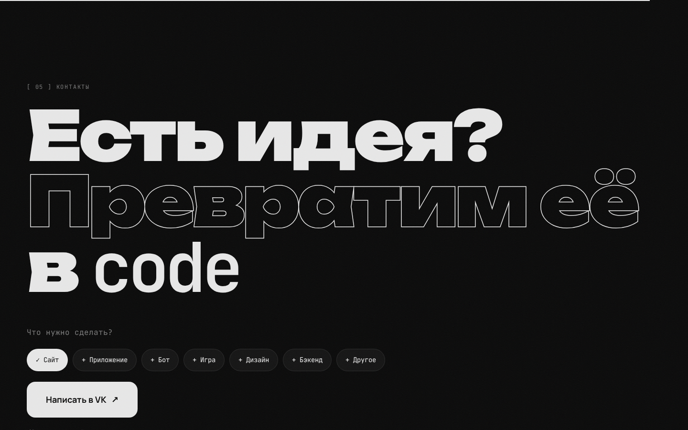

<div align="center">


<br />

**Сайт студии разработки null/code: из нуля — в работающий продукт.**

Сайты · приложения · боты · игры · бэкенд · дизайн

<br />

[](https://react.dev)
[](https://vite.dev)
[](https://motion.dev)
[](https://vk.ru/null.code)

</div>

<br />


## ✦ Что внутри

| | |
| --- | --- |
| **Прелоадер** | Логотип рисуется линиями, счётчик 000 → 100%, экран уезжает вверх |
| **Hero** | Фон из символов кода на canvas: оживает вокруг курсора, по нему бежит скан-линия. Буквы выезжают по одной, подзаголовок «расшифровывается» |
| **Бегущая строка** | Два ряда направлений навстречу друг другу, наклон зависит от скорости скролла |
| **Манифест** | Слова проявляются по мере прокрутки |
| **Услуги** | Карточки с 3D-наклоном и световым пятном под курсором |
| **Процесс** | Горизонтальная лента этапов внутри вертикального скролла |
| **Терминал** | Сам печатает команды, когда попадает в экран |
| **Стек и контакты** | Пружинящие чипы технологий, выбор типа проекта и кнопка в VK |
| **Мелочи** | Свой курсор, магнитные кнопки, зерно, прогресс-бар, плавный скролл (Lenis), `prefers-reduced-motion`, адаптив |

## ✦ Скриншоты

<table>
  <tr>
    <td width="50%"></td>
    <td width="50%"></td>
  </tr>
  <tr>
    <td width="50%"></td>
    <td width="50%"></td>
  </tr>
</table>

<p align="center">
  
</p>

## ✦ Запуск

```bash
npm install
npm run dev       # http://localhost:5173
npm run build     # production-сборка в dist/
npm run preview   # посмотреть сборку локально
```

Нужен Node.js 20+. Шрифты (Unbounded, Manrope, JetBrains Mono) лежат в пакетах `@fontsource`, Google Fonts не нужен.

## ✦ Деплой

**GitHub Pages.** В репозитории уже есть workflow `.github/workflows/deploy.yml`: он собирает сайт при каждом пуше в `main`. Один раз включите в **Settings → Pages → Source: GitHub Actions**.

**Любой другой хостинг** (Vercel, Netlify, свой сервер): соберите `npm run build` и отдайте папку `dist/`.

## ✦ Структура

```
src/
├── App.jsx               # сборка страницы + плавный скролл
├── styles.css            # вся стилизация, токены в :root
└── components/
    ├── Preloader.jsx     # экран загрузки
    ├── Nav.jsx           # шапка, мобильное меню, прогресс
    ├── Hero.jsx          # главный экран
    ├── CodeField.jsx     # canvas-фон из символов
    ├── Marquee.jsx       # бегущая строка
    ├── Manifest.jsx      # текст с проявлением по скроллу
    ├── Services.jsx      # карточки услуг
    ├── Process.jsx       # горизонтальный скролл этапов
    ├── Terminal.jsx      # печатающий терминал
    ├── Stack.jsx         # технологии и цифры
    ├── Contact.jsx       # бриф + ссылка на VK
    ├── Footer.jsx
    └── Logo · Scramble · Magnetic · Reveal · Cursor   # переиспользуемые эффекты
```

## ✦ Что где менять

| Что | Где |
| --- | --- |
| Ссылка на VK | `src/components/Contact.jsx` → `VK_URL` |
| Список услуг | `src/components/Services.jsx` |
| Этапы работы | `src/components/Process.jsx` |
| Технологии и цифры | `src/components/Stack.jsx` |
| Цвета, шрифты, отступы | `src/styles.css` → `:root` |
| Логотип и иконка вкладки | `src/components/Logo.jsx`, `public/logo.svg` |

<br />

<div align="center">
  <sub><code>null/code</code> · from zero to code · <a href="https://vk.ru/null.code">vk.ru/null.code</a></sub>
</div>
